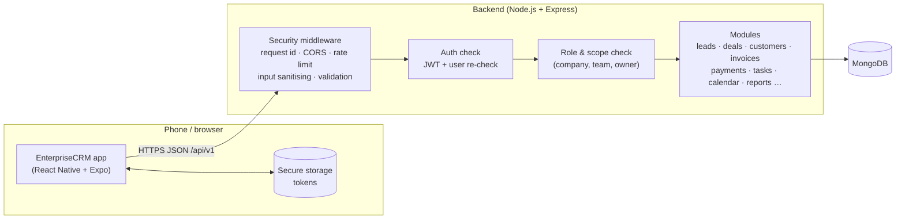
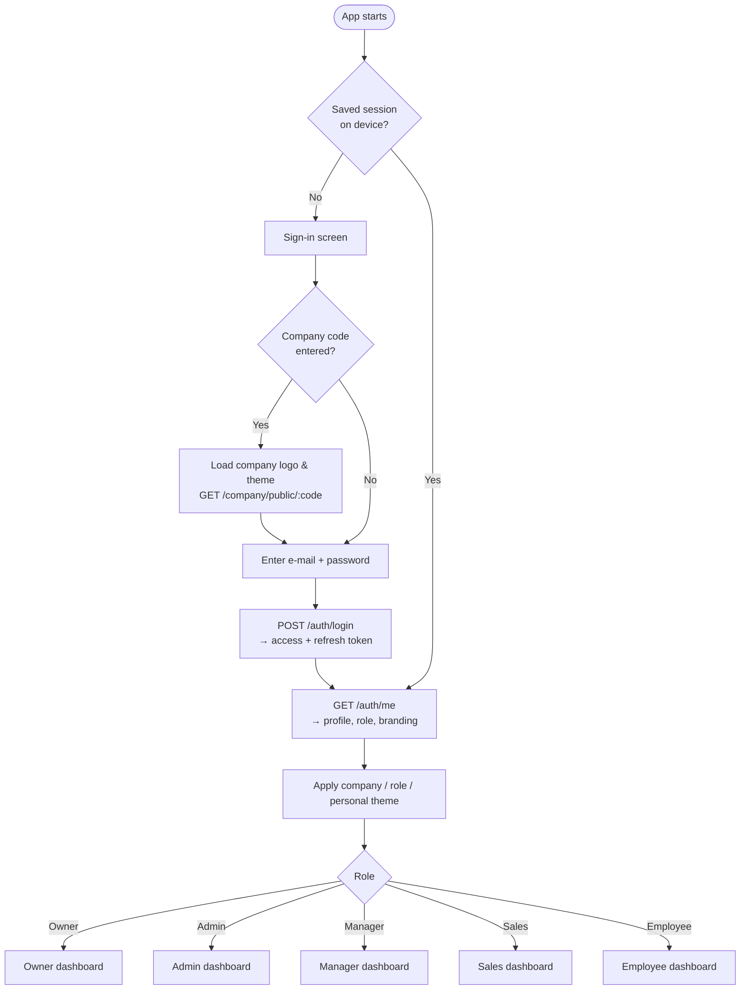
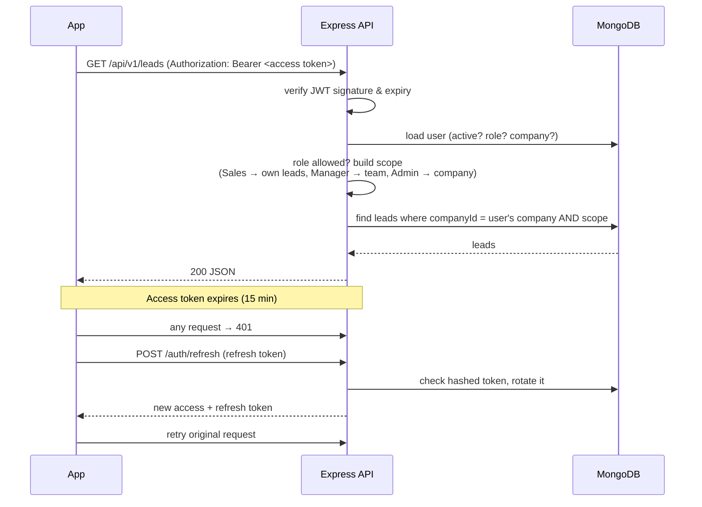
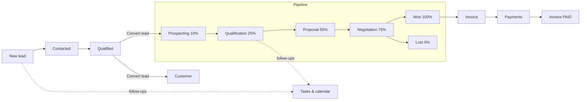
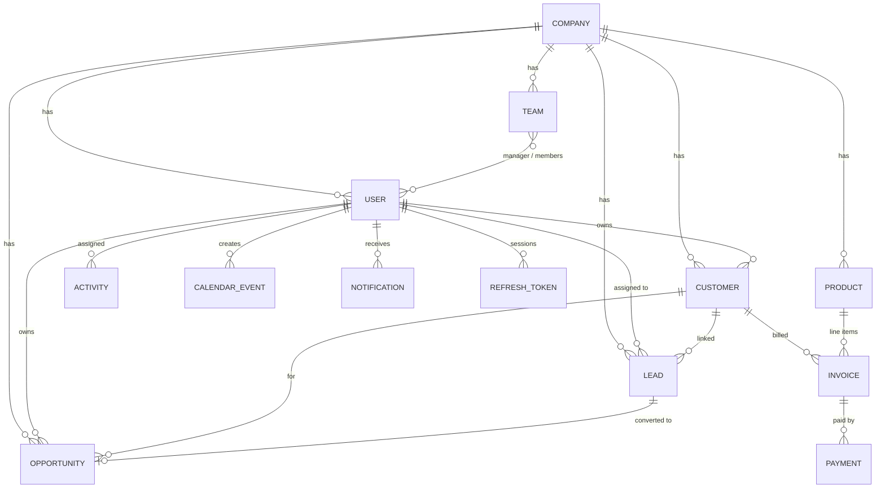

# EnterpriseCRM Pro

A multi-company CRM for small and mid-size sales teams: leads, deals, customers, tasks, products, invoices, payments, calendar, alerts, a visual sales pipeline and analytics — on **Android, iOS and the web** from one React Native codebase, backed by a **Node.js + Express + MongoDB** API.

Every company gets its own look (logo, name, five theme presets, brand colours, dark mode, a theme per role), and every user sees only the data their role allows.

| | |
|---|---|
| **Mobile / web app** | React Native 0.88 · Expo SDK 58 · React 19.3 · TypeScript · Redux Toolkit · React Navigation 7 · react-native-svg |
| **Backend API** | Node.js 20+ · Express 4 · TypeScript · Mongoose 8 · Zod · JWT · bcrypt |
| **Database** | MongoDB 6+ (local or MongoDB Atlas) |
| **Tests** | Node test runner (backend, against a real MongoDB) · Jest + React Native Testing Library (app) |

---

## Contents

1. [Features](#features)
2. [How it works](#how-it-works)
3. [Project structure](#project-structure)
4. [Database](#database)
5. [Roles and permissions](#roles-and-permissions)
6. [What to install](#what-to-install)
7. [Setup, step by step](#setup-step-by-step)
8. [Running the project](#running-the-project)
9. [Building the Android APK](#building-the-android-apk)
10. [Testing](#testing)
11. [API overview](#api-overview)
12. [Troubleshooting](#troubleshooting)
13. [More documentation](#more-documentation)

---

## Features

**Sales**
- **Leads** — capture, assign, qualify, convert to a customer + deal in one step, duplicate warnings on the same e-mail or phone; searchable list with status counts and a lead page with a status tracker, quick call / WhatsApp / e-mail, tasks and history.
- **Deals (pipeline)** — kanban board by stage, list view, move a deal to any stage, win probability and weighted forecast.
- **Customers** — owners, sharing with colleagues, GSTIN, billing address; a customer page with account health, deals, invoices, payments, tasks, meetings, history and a downloadable **statement (PDF)**; call / WhatsApp / e-mail in one tap.
- **Tasks & calls** — tasks, calls, e-mails, meetings and notes linked to leads, customers or deals; due dates and overdue tracking; assign to a person or as a **General (team)** task anyone can pick up; every completed task shows **who completed it and when** (on time or late). Each person sees their own tasks, managers their team's, owner/admin everyone's.
- **Calendar** — month, week and agenda views, type filters, "mine only", event details with linked customer/lead/deal and attendees, PDF agenda. Company events from the owner/admin are shared; other events follow the hierarchy and invitations.

**Billing**
- **Products** — catalogue with price and stock.
- **Invoices** — line items from the catalogue, GST rate, automatic totals and numbering (`INV-0001…`), overdue detection; invoice page with paid/balance progress and history; **download the bill as a GST tax-invoice PDF** (both parties, GSTINs, amount in words, bank details). PDFs download as real files: directly in the browser, into Downloads on Android, via "Save to Files" on iPhone.
- **Payments** — partial payments, balance due; an invoice becomes PAID when fully paid; **payment receipt PDF** for every payment.
- **Company billing details** — legal name, address, GSTIN, phone, e-mail and bank details printed on every bill and receipt (owner only).

**Insight**
- **Dashboards** per role (Owner, Admin, Manager, Sales, Employee).
- **Analytics** — pipeline, lead funnel, monthly deal value, tasks, collected revenue, forecast, top customers, team leaderboard.
- **Reports & Analysis** — Overview, Sales, Money (billed / collected / outstanding, ageing, who pays and who owes, payment methods, who collected) and Team; every report downloads as a PDF. Scoped to the user (company / team / own).
- **Team activity — who did what** — per-person performance (leads, deals, tasks done and late, invoiced, collected) with flags for what was not done, a day-by-day activity feed, and the full history of any deal, lead, customer or invoice.
- **AI Center** — daily briefing, deal win probability with the reasons and a next step, lead scores, at-risk customers, revenue trend — all rule-based from your own data (no external AI service), downloadable as PDF.
- **Alerts** — "Needs attention" (overdue tasks and invoices, stalled deals, cold leads, meetings in the next 48 h) with *why it matters*, plus the inbox of assignments.

**Company & team**
- Multi-company: each company's data is fully separated.
- Team management, roles, suspend/activate users, **teams & territories** (managers see their team's records).
- **Branding & themes** — logo, display name, 5 presets, custom colours, corner style, density, dark mode, theme per role, personal themes; a **company code** shows the company's look on the sign-in screen.
- CSV import/export for leads and customers.

**Security**
- Hashed passwords (bcrypt), short-lived access tokens, rotating refresh tokens with theft detection, password reset, rate limiting, input validation, audit log. Details in [docs/SECURITY.md](docs/SECURITY.md).

---

## How it works

### Big picture



- The **app** is one codebase that runs on Android, iOS and web. It talks to the backend only through the REST API (`/api/v1/...`) using Axios.
- The **backend** checks every request in the same order: security filters → is the user signed in → is this role allowed → which records may this user see. Only then does it read or write MongoDB.
- **MongoDB** stores one set of collections for all companies; every record carries a `companyId`, and the backend always filters by the signed-in user's company.

### What happens when you open the app



### How a request is handled



### Sales workflow



The percentages are the typical win chance used for the **weighted forecast** (deal value × probability).

---

## Project structure

```
EnterpriseCRM/
├─ crm-backend-mongo/          Backend API
│  ├─ src/
│  │  ├─ app.ts                Express app: middleware + routes
│  │  ├─ server.ts             Starts the server, graceful shutdown
│  │  ├─ config/               Environment variables, MongoDB connection
│  │  ├─ middlewares/          auth, roles, validation, security, errors
│  │  ├─ models/               Mongoose schemas (one file per collection)
│  │  ├─ modules/<name>/       routes → controller → service → validation
│  │  │    auth, users, company, teams, customers, leads, opportunities,
│  │  │    activities, products, invoices, payments, calendar,
│  │  │    notifications, dashboard, reports, ai, csv
│  │  └─ utils/                permissions, scope, jwt, hashing, audit, csv …
│  ├─ scripts/migrate.ts       One-time data upgrade script
│  ├─ tests/                   API integration tests
│  └─ .env.example             Configuration template
│
├─ crm-mobile-expo/            Mobile + web app
│  ├─ App.tsx                  Providers: Redux → safe area → theme → navigation
│  ├─ app.json / eas.json      Expo app config and build profiles
│  ├─ src/
│  │  ├─ api/                  Axios client + one file per backend module
│  │  ├─ components/           common UI, form kit, charts, motion, graphics
│  │  ├─ hooks/                useForm, usePickerData, useRefreshOnFocus …
│  │  ├─ navigation/           one navigator per role + shared route types
│  │  ├─ redux/                store + slices (auth, branding, leads, deals …)
│  │  ├─ screens/              feature screens (forms/, pipeline/, analytics/ …)
│  │  ├─ storage/              secure token storage (SecureStore / localStorage on web)
│  │  ├─ theme/                presets, theme builder, ThemeProvider
│  │  ├─ types/                shared TypeScript types
│  │  └─ utils/                permissions, dates, confirm dialog
│  └─ .env.example             Configuration template
│
├─ docs/                       Detailed documentation
└─ .github/workflows/ci.yml    Automatic checks on every push
```

### Backend module pattern

Every feature follows the same four files, so adding one is predictable:

```
modules/leads/
  leads.routes.ts       URL + which roles may call it + which validation applies
  leads.validation.ts   Zod schema for body / query / params
  leads.controller.ts   reads the request, calls the service, sends the response
  leads.service.ts      business logic and database queries (always company-scoped)
```

### App screen pattern

Screens get data through `src/api/*`, keep shared state in Redux where several screens need it, and build forms with the shared form kit (`src/components/form`). Colours, spacing and corner radius always come from the active theme, so company branding and dark mode apply everywhere.

---

## Database

MongoDB, accessed through Mongoose. All business collections have a `companyId`; the API always filters by the signed-in user's company, so companies never see each other's data.



| Collection | What it stores | Key fields |
|---|---|---|
| `companies` | A company workspace | `name`, `slug` (company code), `branding` (logo, preset, colours, role themes), `timezone`, `currency` |
| `users` | People who sign in | `companyId`, `name`, `email` (unique), `passwordHash`, `role`, `isActive`, `preferences` (theme) |
| `teams` | Sales teams / territories | `name`, `territory`, `managerId`, `memberIds[]` |
| `customers` | Businesses or people you sell to | `name`, `email`, `phone`, `gstin`, `address`, `ownerId`, `sharedWithIds[]` |
| `leads` | Potential customers | `name`, `email`, `phone`, `source`, `status`, `assignedToId`, `customerId`, `score` |
| `opportunities` | Deals in the pipeline | `title`, `amount`, `stage`, `closeDate`, `ownerId`, `customerId`, `leadId` |
| `activities` | Tasks, calls, e-mails, meetings, notes | `type`, `summary`, `status`, `dueAt`, `assignedToId`, links to lead/customer/deal |
| `calendarevents` | Team calendar | `title`, `type`, `startAt`, `endAt`, `location`, `attendeeIds[]` |
| `products` | Catalogue | `name`, `sku`, `price`, `stockQty`, `isActive` |
| `invoices` | Bills | `invoiceNumber`, `customerId`, `lineItems[]`, `taxRate`, `subtotal`, `tax`, `total`, `status`, `dueDate` |
| `payments` | Money received | `invoiceId`, `amount`, `method`, `reference`, `paidAt` |
| `notifications` | In-app alerts | `userId`, `type`, `title`, `message`, `isRead` |
| `refreshtokens` | Sign-in sessions (hashed) | `userId`, `tokenHash`, `familyId`, `expiresAt`, `revokedAt` |
| `passwordresettokens` | One-time reset links (hashed) | `userId`, `tokenHash`, `expiresAt`, `usedAt` |
| `auditlogs` | Security-relevant actions | `actorId`, `action`, `targetType`, `targetId` |

Indexes, relationships and upgrade notes: [docs/ARCHITECTURE.md](docs/ARCHITECTURE.md).

---

## Roles and permissions

| Role | Sees | Can |
|---|---|---|
| **Owner** | Whole company | Everything, incl. company profile, branding, admins |
| **Admin** | Whole company | Everything except managing other admins / the owner and the company profile |
| **Manager** | Their team's records (whole company if they lead no team) | Create and edit sales records, reports and analytics |
| **Sales** | Only their own leads, deals and customers (and customers shared with them) | Create and edit their own sales records, invoices, payments |
| **Employee** | Only their own records | Tasks, calendar, notes; view-only for sales data |

The same hierarchy applies to **tasks, calendar, alerts, reports, team activity and AI insights**: Owner/Admin → whole company, Manager → their team and themselves, Sales/Employee → their own work.

Rules are enforced **on the server** for every request; the app only hides buttons a role can't use. Full matrix: [docs/ROLE_PERMISSIONS.md](docs/ROLE_PERMISSIONS.md).

---

## What to install

| Tool | Version | Why | Get it |
|---|---|---|---|
| **Node.js** | 20 LTS or newer (tested on 24) | Runs the backend and the app tooling | https://nodejs.org |
| **npm** | 10+ (comes with Node) | Installs packages | — |
| **MongoDB** | 6+ | The database | Local: https://www.mongodb.com/try/download/community · Cloud: https://www.mongodb.com/atlas |
| **Git** | any | Clone the project | https://git-scm.com |
| **Expo Go** (phone) | for SDK 58 | Run the app on your phone during development | Play Store / App Store |
| *Optional* Android Studio | latest | Android emulator, or building an APK locally | https://developer.android.com/studio |
| *Optional* MongoDB Compass | latest | Look at the data | https://www.mongodb.com/products/compass |

You do **not** need to install Expo globally — `npx expo …` uses the project's own version.

---

## Setup, step by step

### 1. Get the code

```bash
git clone https://github.com/Harsh-Mandaliya/EnterpriseCRM.git
cd EnterpriseCRM
```

### 2. Start MongoDB

- **Local:** install MongoDB Community and make sure the service is running (Windows: *Services → MongoDB Server*). Default address: `mongodb://localhost:27017`.
- **Atlas:** create a free cluster, a database user, allow your IP, and copy the connection string.

### 3. Configure and install the backend

```bash
cd crm-backend-mongo
npm ci
cp .env.example .env        # Windows CMD: copy .env.example .env
```

Open `.env` and set at least:

```env
MONGODB_URI=mongodb://localhost:27017/crm_db
JWT_ACCESS_SECRET=<long random text>
JWT_REFRESH_SECRET=<different long random text>
```

Generate the two secrets (run twice, use a different value for each):

```bash
node -e "console.log(require('crypto').randomBytes(48).toString('hex'))"
```

All other settings (port, CORS, rate limits, Google sign-in) are explained in `.env.example` and [docs/ENVIRONMENT.md](docs/ENVIRONMENT.md).

**Upgrading an existing database** from an older version? Back it up, then run once:

```bash
npm run migrate
```

### 4. Configure and install the app

```bash
cd ../crm-mobile-expo
npm ci
cp .env.example .env
```

Set the address of your backend in `crm-mobile-expo/.env`:

```env
# Phone on the same Wi-Fi as your PC → use your PC's LAN IP
EXPO_PUBLIC_API_URL=http://192.168.1.20:4000/api/v1
```

| Where the app runs | Use |
|---|---|
| Real phone (Expo Go or APK) | `http://<your PC's LAN IP>:4000/api/v1` |
| Android emulator | `http://10.0.2.2:4000/api/v1` |
| iOS simulator / web browser | `http://localhost:4000/api/v1` |
| Production | `https://your-domain.com/api/v1` |

Find your LAN IP: Windows `ipconfig` (IPv4 Address) · macOS `ipconfig getifaddr en0` · Linux `ip addr`.

> A phone cannot reach `localhost` on your PC — `localhost` on a phone is the phone itself.

---

## Running the project

Open two terminals.

**Terminal 1 — backend**

```bash
cd crm-backend-mongo
npm run dev
```

You should see `Connected to MongoDB` and `CRM backend listening on http://0.0.0.0:4000`. Check it in a browser: http://localhost:4000/api/v1/health → `{"status":"ok"}`.

**Terminal 2 — app**

```bash
cd crm-mobile-expo
npx expo start
```

- **Phone:** scan the QR code with Expo Go (Android) or the Camera app (iOS). Phone and PC must be on the same Wi-Fi. If it can't connect, try `npx expo start --tunnel`.
- **Android emulator:** press `a`. **Web:** press `w`.

**First use**

1. Tap **Create a workspace** → enter your company name, then your name, e-mail and password. You become the **Owner**.
2. Profile → **Manage team** → add Admin / Manager / Sales / Employee users.
3. Profile → **Teams & territories** → group sales reps under a manager (optional).
4. Profile → **Theme & branding** → logo, colours, theme per role. Share the **company code** so teammates see your branding on the sign-in screen.
5. Profile → **Billing details** → address, GSTIN and bank details for your bills and receipts.
6. Start adding leads, deals, customers, tasks and invoices.

### Useful scripts

| Folder | Command | What it does |
|---|---|---|
| backend | `npm run dev` | Start with auto-reload |
| backend | `npm run build` then `npm start` | Compile and run for production |
| backend | `npm test` | API integration tests (needs MongoDB) |
| backend | `npm run typecheck` | TypeScript check |
| backend | `npm run migrate` | Upgrade an existing database (back up first) |
| backend | `npm run seed:demo` | Create two demo companies with data in every module (see `docs/DEMO_DATA.md`) |
| backend | `npm run backfill:worklog -- [company codes] [--dry]` | Build "who did what" history for records created before v1.4 (adds entries only) |
| app | `npx expo start` | Start the app |
| app | `npm test` | App tests |
| app | `npm run typecheck` / `npm run lint` | Code checks |
| app | `npx expo-doctor` | Check the Expo setup |
| app | `npx expo export --platform web` | Production web build |

---

## Building the Android APK

The backend address is **built into** the APK from `EXPO_PUBLIC_API_URL`, so set it in `crm-mobile-expo/.env` first:
- LAN IP (e.g. `http://192.168.1.20:4000/api/v1`) → the APK works when the phone is on the same Wi-Fi as the PC running the backend.
- A public `https://…/api/v1` address → works anywhere.

Android release builds normally block plain `http`. So that a LAN address like `http://192.168.x.x:4000` works, `app.json` enables it with the `expo-build-properties` plugin (`android.usesCleartextTraffic: true`). For a public deployment use an `https://` URL and remove that setting.

### Option A — Expo EAS (cloud, easiest)

Needs a free Expo account (https://expo.dev).

```bash
cd crm-mobile-expo
npm install -g eas-cli
eas login
eas build -p android --profile preview
```

The `preview` profile in `eas.json` produces an installable **APK**. When the build finishes, EAS shows a link and QR code — open it on the phone to download and install. (`--profile production` makes an `.aab` for the Play Store.)

### Option B — build on your own PC

Needs **Android Studio** (it installs the Android SDK) and **JDK 17 or 21**.

1. Install Android Studio → *More Actions → SDK Manager* → install the latest Android SDK Platform and Build-Tools.
2. Set the environment variable `ANDROID_HOME` to the SDK folder (Windows default: `C:\Users\<you>\AppData\Local\Android\Sdk`).
3. Build:

```bash
cd crm-mobile-expo
npx expo prebuild --platform android
cd android
./gradlew assembleRelease          # Windows: gradlew.bat assembleRelease
```

The APK is created at:

```
crm-mobile-expo/android/app/build/outputs/apk/release/app-release.apk
```

Copy it to the phone and install it (allow *Install unknown apps* for your file manager).

> The `android/` folder generated by `prebuild` is not committed; regenerate it any time. By default the release build is signed with a debug key — fine for testing, but create your own keystore before publishing to the Play Store: https://reactnative.dev/docs/signed-apk-android

---

## Testing

```bash
# Backend — needs MongoDB running; each test file uses its own temporary database
cd crm-backend-mongo
npm test

# App
cd crm-mobile-expo
npm run typecheck
npm run lint
npm test
```

The backend tests cover sign-in and sessions, company isolation, role and team rules, branding, lead conversion, duplicates, CSV import/export and reports. The app tests cover the theme engine, forms, pipeline maths, role-aware screens and the API client. Every push to GitHub runs these checks automatically (`.github/workflows/ci.yml`). Details: [docs/TESTING.md](docs/TESTING.md).

---

## API overview

Base URL: `http://<host>:4000/api/v1` · JSON · `Authorization: Bearer <access token>` on everything except sign-in, registration, password reset and the public company lookup.

| Area | Endpoints |
|---|---|
| Health | `GET /health`, `GET /ready` |
| Auth | `POST /auth/register`, `/login`, `/refresh`, `/logout`, `/logout-all`, `/forgot-password`, `/reset-password`, `/google` · `GET /auth/me` |
| Company & branding | `GET /company/public/:code`, `GET/PATCH /company/branding`, `PATCH /company/profile` (incl. `billing`), `PATCH /company/preferences` |
| Users & teams | `/users`, `/teams` (CRUD) |
| Sales | `/customers`, `/leads` (+ `/:id/convert`, `/duplicates`, `/export`, `/import`), `/opportunities` (+ `/:id/stage`) |
| Work | `/activities` (+ `/:id/complete`), `/calendar`, `/notifications` |
| Billing | `/products`, `/invoices` (+ `/:id/status`), `/payments` |
| Insight | `/dashboard/*-summary`, `/reports/sales|leads|deals|top-customers`, `/ai/*` |
| Insight (v1.4, every role, scoped) | `GET /reports/team-performance?days=`, `/reports/work-log?days=&userId=&targetType=&targetId=`, `/reports/receivables`, `/notifications/attention`, `/ai/deal-insights`, `/ai/briefing` |

Every endpoint, request body and error code: [docs/API.md](docs/API.md).

---

## Troubleshooting

| Problem | Fix |
|---|---|
| App says *Cannot reach the server* / registration fails on a phone | `EXPO_PUBLIC_API_URL` must use your PC's **LAN IP**, phone and PC on the same Wi-Fi, backend running. Allow Node.js through the Windows firewall (port 4000). Restart `npx expo start` after changing `.env`. |
| *Project is incompatible with this version of Expo Go* | The app uses SDK 58 — update Expo Go from the store. Run `npx expo install --check` in `crm-mobile-expo`. |
| Backend stops with *Missing required environment variable* | Create `crm-backend-mongo/.env` from `.env.example` and fill it in. |
| Backend can't connect to MongoDB | Start the MongoDB service, or check the Atlas connection string, user/password and IP allow-list. |
| *JWT_ACCESS_SECRET and JWT_REFRESH_SECRET must be different* | Use two different random values. |
| Sign-in returns 409 on an older database | Restart the backend (it removes an outdated index on start) and run `npm run migrate`. |
| `429 Too many requests` when signing in | Too many attempts — wait 15 minutes (`AUTH_RATE_LIMIT_WINDOW_MS`). |
| Port 4000 already in use | Another backend is running — stop it, or set `PORT=4100` in `.env` and update the app's URL. |
| APK installs but shows network errors | The URL inside the APK is wrong for that network — rebuild after updating `EXPO_PUBLIC_API_URL`. |
| `/auth/google` returns 503 | Google sign-in is not configured (`GOOGLE_CLIENT_ID`). |

---

## More documentation

| Document | Contents |
|---|---|
| [docs/INSTALLATION.md](docs/INSTALLATION.md) | Installation details |
| [docs/ENVIRONMENT.md](docs/ENVIRONMENT.md) | Every configuration variable |
| [docs/ARCHITECTURE.md](docs/ARCHITECTURE.md) | Backend, app and database design |
| [docs/API.md](docs/API.md) | All endpoints |
| [docs/ROLE_PERMISSIONS.md](docs/ROLE_PERMISSIONS.md) | Full role × action matrix |
| [docs/SECURITY.md](docs/SECURITY.md) | Security measures and open risks |
| [docs/THEMING.md](docs/THEMING.md) | Branding and themes |
| [docs/DESIGN_SYSTEM.md](docs/DESIGN_SYSTEM.md) | Motion, charts and the form kit |
| [docs/TESTING.md](docs/TESTING.md) | Tests and results |
| [docs/DEPLOYMENT.md](docs/DEPLOYMENT.md) | Production deployment, backups, rollback |
| [docs/CHANGELOG.md](docs/CHANGELOG.md) | Version history |
| [docs/KNOWN_LIMITATIONS.md](docs/KNOWN_LIMITATIONS.md) | Known gaps and planned work |

---

## Author

**Harsh Mandaliya** — [github.com/Harsh-Mandaliya](https://github.com/Harsh-Mandaliya)
